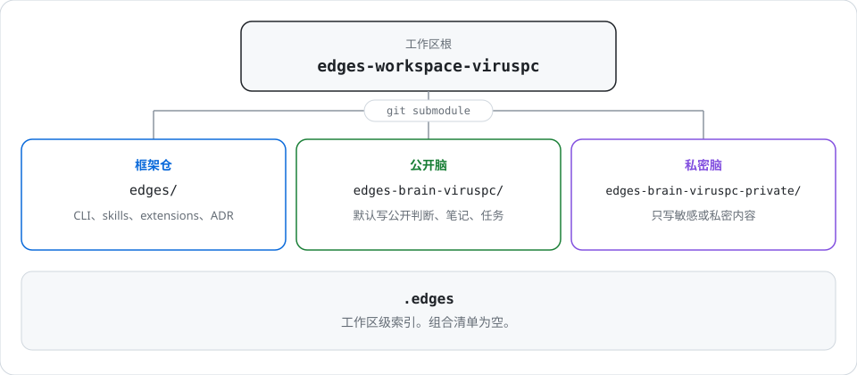

# edges-workspace-viruspc

peng cheng 的默认工作区。本仓库是入口和索引；笔记、任务和框架代码写在根目录的三个内容子模块里。

## 布局



## 三个内容目录

这三个目录是普通 git submodule，登记在根目录的 `.gitmodules`。`.harness/compose/README.md` 的组合清单目前为空。

| 目录 | 是什么 | 写什么 |
| --- | --- | --- |
| [`edges/`](https://github.com/VirusPC/edges) | Edges 框架仓 | CLI、skills、extensions、ADR。改框架能力时写这里。 |
| [`edges-brain-viruspc/`](https://github.com/VirusPC/edges-brain-viruspc) | 公开脑 | 跨项目的公开判断、笔记、任务。默认写这里。 |
| [`edges-brain-viruspc-private/`](https://github.com/VirusPC/edges-brain-viruspc-private) | 私密脑 | 敏感或私密内容。 |

## 克隆

```bash
git clone https://github.com/VirusPC/edges-workspace-viruspc.git
cd edges-workspace-viruspc
git submodule update --init
```

私密脑需要 [edges-brain-viruspc-private](https://github.com/VirusPC/edges-brain-viruspc-private) 的访问权限。某个目录还是空的时，在仓库根执行 `git submodule update --init -- <目录>`。

## 写到哪里

- 公开内容写 `edges-brain-viruspc/`。
- 私密内容写 `edges-brain-viruspc-private/`。
- 框架改动写 `edges/`。
- 还没归档的草稿、截图和预览放 `.work/<任务名>/`。这是本地暂存，长期内容再归入对应子模块。

笔记、任务、记忆、技能和项目怎么组织，读目标目录自己的 `README.md`；该目录有 `AGENTS.md` 时一并阅读。

## 给 Agent

人读本文件。Agent 读 [`AGENTS.md`](AGENTS.md)，再读要写入的那个内容子模块的 `README.md` 和 `AGENTS.md`。
